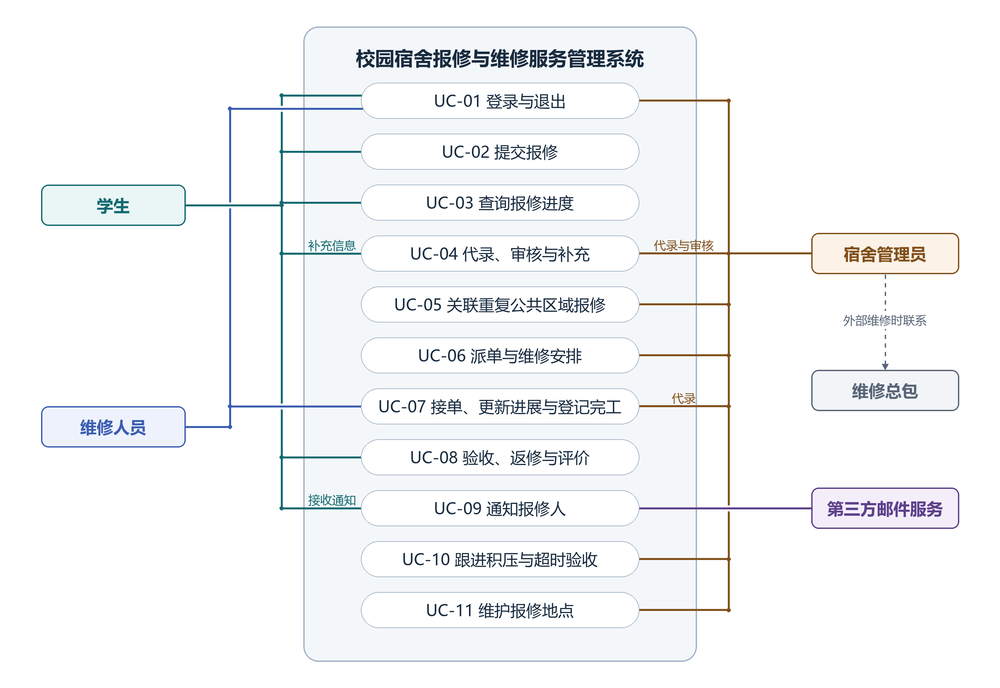

# 校园宿舍报修与维修服务管理系统软件需求规格说明书

## 1. 项目范围

系统服务于一个校区的学生宿舍，覆盖宿舍房间与楼道等公共区域的水电、门锁及其他设施日常故障。系统为每次报修生成可查询的工单，记录从收单到验收的责任人、时间和处理结果。学生可以查看下一步及预计上门时段。维修完成后，学生可确认、稍后验收或反馈未修好。

校内调研记录的现行流程由宿管联系总包，再由总包安排维修人员上门。

系统的目标流程由宿管在站内把工单派给指定维修人员。维修人员登录后从「我的任务」接单、更新进度并提交完工结果，学生随后验收。需要由未接入系统的维修力量处理时，宿管可联系总包并代录转交、安排、进度和结果。紧急故障使用校方确认的值班渠道，处置后可补录。

## 2. 参与者与用例

| 参与者 | 类型 | 职责与数据范围 |
| --- | --- | --- |
| 学生 | 主要参与者 | 提交、补充和查询本人相关报修。主工单报修人负责验收，并可评价本人确认完工的工单。关联报修人查看公共区域主工单的共享进度。 |
| 宿舍管理员 | 主要参与者 | 在所管楼栋代录、审核、关联重复报修、站内派单和改派，跟进超时并维护报修地点。外部维修由宿管转交和代录。 |
| 维修人员 | 主要参与者 | 登录「我的任务」，查看并接单当前指派给本人的工单，登记进展与完工结果。 |
| 维修总包 | 外部维修协作方 | 在外部维修路径中接收宿管转交，反馈人员安排、预计上门时段和维修结果。 |
| 第三方邮件服务 | 次要参与者 | 接收系统提交的邮件发送请求并返回接收结果。 |

[Mermaid 源文件](../../models/srs-use-cases.mmd)

## 3. 工单流程与业务规则

| 当前状态 | 操作与条件 | 结果 |
| --- | --- | --- |
| 创建前 | 学生提交有效报修，或宿管在权限范围内代录 | 待受理，生成唯一工单号 |
| 待受理 | 宿管核实信息并受理 | 已受理 |
| 待受理 | 宿管填写补充事项并退回 | 待补充 |
| 待补充 | 原报修人完成补充 | 待受理，沿用原工单号 |
| 本轮尚未独立派单或转交的未关闭公共区域报修 | 宿管确认与同一地点的未关闭主工单属同一故障 | 重复报修标记为已关联，显示主工单的共享进度 |
| 已受理、待返修 | 宿管站内派单，指定维修人员并填写预计上门时段和在场要求 | 已安排，进入该维修人员的待接单列表 |
| 已受理、待返修 | 采用外部维修，宿管登记本轮向总包转交 | 已转交 |
| 已转交 | 宿管根据总包反馈保存预计上门时段 | 已安排 |
| 已安排 | 被指派的维修人员在站内接单，或宿管对外部维修代录开工反馈 | 维修中 |
| 已安排、维修中 | 宿管调整时段或改派并填写原因 | 单独调整时段时沿用当前状态。维修中完成改派后回到已安排。 |
| 维修中 | 当前负责的维修人员提交完工结果，或宿管代录外部维修结果 | 待验收 |
| 待验收 | 主工单报修人稍后验收，或本轮待验收已满 48 小时〔待评审〕 | 继续待验收，达到阈值时显示超时标记 |
| 待验收 | 主工单报修人确认修好 | 已关闭 |
| 待验收 | 主工单报修人填写未修好原因 | 待返修，保留前轮记录并新增一轮 |
| 已关闭 | 原报修人因故障复发提交关联报修 | 新工单待受理，并关联原工单号 |

常规处理顺序为提交、受理、站内派单、维修人员接单及完工、学生验收。每轮只保留一种有效的派发路径。采用外部维修且总包仅确认收到时，工单保持「已转交」，学生端显示「待安排」。入室受阻、缺配件或时段不便时，授权人员记录原因和下一步，宿管继续协调。同一轮次的确认修好与未修好反馈只允许其中一项生效。

## 4. 功能需求

### US-01 账号登录与退出

**用例** UC-01 · **优先级** P0

系统支持学生、宿管和维修人员使用已启用的业务账号登录和退出。

- 已启用账号以正确凭据登录后进入相应角色首页，刷新页面仍保持会话。
- 凭据错误或账号停用时，显示通用登录失败提示，且不建立会话。退出后再次访问受保护工单，引导重新登录并停止返回工单数据。

### US-02 提交房间或公共区域报修

**用例** UC-02 · **优先级** P0

学生可通过统一入口选择可报修的房间或公共区域，填写故障类别和描述。类别无法判断时可选择「其他」。

- 有效提交后生成唯一工单号，显示「待受理」和下一步提示。缺少可定位地点或故障描述时显示字段错误、保留已填数据且不创建工单。
- 校方确认的值班渠道已配置时，紧急故障指引显示该渠道和优先联系提示。

### US-03 添加故障照片

**用例** UC-02 · **优先级** P0

学生可选填故障照片，单张上限暂定为 5 MiB，支持 JPG 和 PNG。

- 上传不超过上限且能解码的 JPG 或 PNG 时，表单显示预览，提交后授权用户可在工单详情查看。
- 超限或无法解码为受支持的图片时，提示大小或格式错误，保留其他字段及已上传照片。必填项齐全时可以无附件提交，工单附件区显示「无附件」。

### US-04 查看我的报修与进度

**用例** UC-03 · **优先级** P0

学生可查看本人提交、宿管代录及本人参与关联的工单。

- 列表只展示本人相关工单，显示编号、状态和更新时间。详情显示当前状态、负责角色、最近更新时间和下一步。
- 已受理但尚未站内派单时，详情提示等待维修安排。采用外部维修且已经转交时，尚无时段则显示「待安排」。宿管登记时段及在场要求后，学生可查看最新信息。

### US-05 宿管代录群聊或线下报修

**用例** UC-04 · **优先级** P0

宿管可在所管楼栋代录群聊和线下报修，并关联可识别的报修学生。

- 选定报修学生及来源，填写地点与描述后，生成「待受理」工单，记录来源、代录人和时间。报修学生可在「我的报修」中查看。
- 缺少可识别的报修学生或楼栋超出管理范围时，拒绝保存并说明原因。

### US-06 审核报修与要求补充

**用例** UC-04 · **优先级** P0

宿管核对待受理工单的故障位置和现象，决定受理或要求补充。

- 确认受理后，状态变为「已受理」，时间线记录操作人和时间，下一步提示宿管安排维修。宿管可站内派单，外部维修时可登记转交总包。
- 填写补充事项后退回，状态变为「待补充」，学生可查看事项，系统生成通知记录。补充事项为空或状态不允许时拒绝退回，并显示原因。

### US-07 补充报修信息并重新提交

**用例** UC-04 · **优先级** P0

报修学生可在原工单查看退回原因并补交信息。

- 待补充工单完成补交后沿用原工单号，保存补充前后的信息及提交时间，状态回到「待受理」。
- 从旧页面提交时，若工单已经离开「待补充」，提示刷新查看最新状态，保留原处理记录。

### US-08 关联重复公共区域报修

**用例** UC-05 · **优先级** P0

宿管可在所管范围内，将经人工核实属于同一公共设施故障的重复报修关联至主工单。

- 两张工单均未关闭且候选重复单本轮尚未独立派单或转交时，关联后保留双方报备记录，重复单进入「已关联」，后续由主工单统一派单或转交。
- 地点不同、涉及房间报修或候选重复单本轮已经派单或转交时，拒绝关联并说明原因。
- 关联报修人可查看共享状态、时间、时段和公开处理结果。共享页面隐藏他人的身份、联系方式和私有附件。

### US-09 登记向总包转交

**用例** UC-06 · **优先级** P0

采用外部维修时，宿管可为已受理或待返修的工单登记向总包实际转交的情况。

- 首次录入本轮接收方和实际转交时间后，状态变为「已转交」，记录经手人、接收方、时间和轮次。
- 本轮已经站内派单或已经转交时，拒绝重复派发并提示当前处理路径。尝试转交已关联的重复单时，提示查看主工单。上述情况均不新增转交记录。

### US-10 站内派单与登记预计上门时段

**用例** UC-06 · **优先级** P0

宿管可将所管楼栋的已受理或待返修工单派给已启用账号的维修人员。两条路径均记录预计上门起止时间和在场要求。

- 站内派单时，宿管选定维修人员并保存有效时段后，工单从「已受理」或「待返修」直接进入「已安排」。系统记录派单人、维修人员、派单时间和轮次，并将工单加入该维修人员的待接单列表。学生可查看时段和在场要求，系统生成通知任务。
- 外部维修已转交时，宿管保存总包反馈的有效时段与在场要求后，工单进入「已安排」。系统在工单中保存外部安排并通知学生，维修人员的待接单列表不新增任务。上门时段未定时，保留「已转交」，显示「待安排」。
- 站内派单时，若维修账号无效或本轮已派单、已转交，系统拒绝派单并提示原因。两条路径均拒绝超出所管楼栋范围、缺少起止时间或结束时间不晚于开始时间的操作，拒绝后保留原状态，且不新增安排记录或通知。

### US-11 改派维修人员或调整上门时段

**用例** UC-06 · **优先级** P0

工单处于「已安排」或「维修中」时，宿管可调整站内维修人员或时段。外部维修的改派和时段变更由宿管根据总包反馈登记。

- 有原因的变更成功后，记录旧值、新值、操作人和时间。时段调整后通知相关报修人。人员改派后撤销旧人员对当前任务的访问权。
- 维修中发生改派时，保留旧人员的处理历史并回到「已安排」。站内改派后，任务进入新维修人员的待接单列表。缺少变更原因或工单已待验收时，拒绝变更并提示原因。

### US-12 查看本人维修任务并接单

**用例** UC-07 · **优先级** P0

维修人员可登录「我的任务」，对当前指派给本人且处于「已安排」的工单接单。

- 待接单列表展示当前指派给本人的待接单任务及维修所需的地点与故障信息。接单成功后，工单进入「维修中」，记录接单人和接单时间。
- 工单未指派给本人、已改派或已由其他有效操作改变状态时，接单请求被拒绝，且不新增接单记录。

### US-13 记录维修进展与受阻原因

**用例** UC-07 · **优先级** P0

站内维修由当前被派单的维修人员记录进展、受阻原因与下一步。外部维修由宿管根据反馈代录。

- 维修人员接单后保存进展，本轮时间线显示处理记录和时间。宿管收到外部开工反馈并代录后，可将外部维修从「已安排」更新为「维修中」。
- 已安排或维修中的任务受阻时，记录原因与下一步并沿用当前状态。学生可见公开进展，宿管可查完整协调记录。缺原因或下一步时提示补齐，且不新增记录。

### US-14 登记维修结果并发起验收

**用例** UC-07 · **优先级** P0

站内维修由当前负责的维修人员提交本轮实际维修结果。外部维修由宿管代录，照片选填。

- 「维修中」工单提交有效结果后进入「待验收」，结果保存到当前轮次。学生可见公开结果，系统生成验收通知任务。
- 结果为空或提交者因改派失去权限时，提示拒绝原因，且不生成验收通知。

### US-15 确认完工或稍后验收

**用例** UC-08 · **优先级** P0

主工单报修人可查看维修结果，并在本轮待验收时确认修好或稍后确认。

- 确认修好后，工单进入「已关闭」，记录确认人、时间和轮次。选择稍后确认时，返回工单详情或列表并保留后续验收入口。
- 系统拒绝关联报修人提交验收，也拒绝已处理轮次的重复验收请求，保留现有验收记录和工单状态。

### US-16 申请返修与关联复发报修

**用例** UC-08 · **优先级** P0

主工单报修人可在待验收阶段反馈故障仍在，也可针对本人已关闭且复发的工单发起关联报修。

- 待验收时填写原因并提交未修好反馈，原工单进入「待返修」，新增一轮并保留此前的派单或转交记录、维修结果及验收失败原因。原因缺失时提示补充，并保留待验收状态。
- 已关闭工单上的复发报修提交成功后，生成新的「待受理」工单并保存原工单号，原工单保持已关闭。

### US-17 提交维修评价

**用例** UC-08 · **优先级** P1

学生可对本人确认完工的工单提交一次评分及可选意见，评分暂定为 1–5 星。

- 有效提交后保存一份评价，报修学生和授权宿管可查看评分及提交时间。
- 未确认关闭、已有评价或评分超出范围时，拒绝保存并提示原因。

### US-18 发送报修关键进度邮件

**用例** UC-09 · **优先级** P0

系统在要求补充、确认或更改上门时段、发起验收时通知相关报修人。邮件包含工单号、事件和登录后查看的入口。

- 报修人有有效邮箱且邮件服务可用时，系统保存通知记录，并在触发后 1 分钟内获得邮件服务的接收确认〔待评审〕。
- 邮件服务故障时，业务状态更新可正常查询，系统保留失败记录及可重试任务。已经获得接收确认的同一通知事件重放时，沿用已有发送记录，且不重复请求邮件服务。

### US-19 跟进楼栋积压与超时验收

**用例** UC-10 · **优先级** P1

宿管可在所管楼栋按楼栋和工单状态筛选积压，查看筛选总数和超时验收工单。

- 待验收满 48 小时〔待评审〕时显示超时标记。启用超时筛选后只列出所管范围内达到阈值的待验收工单，列表与计数使用同样的筛选条件。
- 标记超时后，学生仍可确认修好或反馈未修好。

### US-20 维护楼栋房间与公共区域

**用例** UC-11 · **优先级** P1

宿管可在所管范围内新增、编辑或停用房间与公共区域。

- 同一楼栋同类位置内编号唯一。有效且启用的位置出现在新报修地点选项中。编号重复或越权时拒绝保存。
- 停用位置后，新报修可选范围移除该位置，历史工单仍显示登记时的地点。

## 5. 非功能需求

### NFR-01 工单和附件的访问控制

**优先级** P0

访问控制同时校验登录状态、角色、所管楼栋及工单归属。列表、详情、附件和处理操作均受相应范围约束。

- 未登录访问受保护的工单或附件接口时返回 HTTP 401，响应不含受保护数据。登录后越权读取或写入时返回 HTTP 403 或 404，且无资源数据泄露或业务写入。
- 验收覆盖学生跨人访问、宿管跨楼栋访问、维修人员访问未分配或已改派工单，以及直接请求私有附件。具有共享权限的关联报修人和具有任务权限的维修人员，只收到对应角色获准读取的字段。

### NFR-02 工单查询响应性能

**优先级** P1 · **状态** 指标待评审

按下列负载验收学生和宿管使用的工单列表及详情查询。统计由压测端采集。

- 应用和数据库运行在同一台 4 vCPU、8 GiB 的测试主机，预置 10,000 张工单，列表每页 20 条。预热 1 分钟后，由 30 个已登录的并发虚拟用户以 1∶1 的比例请求列表首页和工单详情，持续 5 分钟。
- 列表与详情分别计算，每类接口的 P95 响应时间不超过 2 秒，请求失败率低于 1%。压测报告分列请求数、P95、失败率和实际测试环境。

### NFR-03 工单提交幂等与状态一致性

**优先级** P0

重试和并发处理须保持工单状态、处理轮次和时间线一致。

- 工单已入库但客户端未收到响应时，同一学生使用同一提交标识重试同一报修信息，返回原工单号。结果中只有一张对应工单和一条初始状态记录。
- 同一待验收工单同一版本并发收到确认修好和未修好反馈时，仅一个请求改变状态。另一请求收到状态已变化的提示，工单、轮次及时间线均与成功请求相符。
- 同一轮同时收到站内派单与外部转交的有效请求时，仅一个请求成功写入。另一请求提示刷新查看安排，维修人员任务列表和工单时间线与成功路径一致。

### NFR-04 手机报修与键盘可操作性

**优先级** P1 · **状态** 指标待评审

移动端应能完成报修、查询及验收，桌面端的报修表单支持仅用键盘填写和提交。

- 在 360 × 800 和 390 × 844 CSS 像素视口中，完成报修、查看「我的报修」与待验收操作。页面无需横向滚动，主要控件、状态文字及校验提示完整可见且可操作。
- 在桌面浏览器中，仅使用 Tab、Shift+Tab、Enter、Space 和方向键完成必填项与提交。焦点顺序符合表单顺序，焦点清晰可见。

### NFR-05 关键操作审计与历史保留

**优先级** P0

系统保存受理、站内派单、外部转交、安排、接单、改派、完工、返修与关闭等成功变更的审计记录。

- 授权宿管查询时，每条记录至少有工单号、轮次、操作人、时间、前后状态。改派额外记录前后维修人员和原因。
- 经改派和返修后，先前轮次的记录与维修结果仍可按时间查询。普通业务角色无法通过工单操作修改上述历史。

## 6. 约束条件

| 编号 | 约束 | 验证依据 |
| --- | --- | --- |
| CON-01 | 试点覆盖一个校区的宿舍房间及公共区域。紧急故障使用校方确认的值班渠道。 | 核对试点楼栋和地点数据，核对紧急指引配置。 |
| CON-02 | 按仓库既定前后端分离方案交付浏览器端应用。后端采用 Java 21、Spring Boot 4.0.x、Maven 3.9.x，数据库采用 MySQL 8.4。前端采用 Vue 3、TypeScript 和 Vite，构建环境使用 Node.js 24 LTS，版本至少为 24.12。 | 核对项目运行说明和依赖配置。 |
| CON-03 | 前后端通过 REST API 交换 JSON 业务数据，使用 Spring Security 的 Session 认证及角色授权。报修照片保存在后端可配置目录，通知经第三方邮件服务发送。 | 核对接口、认证、附件目录和邮件服务配置，并按 US-01、US-03、US-18 和 NFR-01 验收。 |

## 7. 评审与变更管理

下列业务口径和验收指标由评审确认后纳入需求基线。

| 待确认事项 | 当前口径 | 关联需求 |
| --- | --- | --- |
| 补充后的受理流程 | 学生补充后沿用原工单号，回到「待受理」由宿管核对。 | US-06、US-07 |
| 站内派单与外部协作 | 本稿以宿管站内派单、指定维修人员接单为常规路径。评审确认宿管的派单权限、维修人员账号开通范围和使用外部转交的条件，并同步更新相关 Issue 的验收标准。 | US-08–US-14、NFR-03、NFR-05 |
| 公共区域验收与超时 | 主工单报修人验收。待验收满 48 小时标记超时，学生仍可进行验收。 | US-08、US-15、US-16、US-19 |
| 照片、评分与通知 | 单张照片上限 5 MiB，评分 1–5 星，邮件服务在触发后 1 分钟内确认接收。 | US-03、US-17、US-18 |
| 性能及可操作性 | 采用第 5 节的负载、P95 与失败率指标，以及移动视口和键盘操作验收条件。 | NFR-02、NFR-04 |

## 附录 A 需求追溯矩阵 v0

| 需求 ID | 用例编号 | GitHub Issue |
| --- | --- | --- |
| US-01 | UC-01 | [#4](https://github.com/huangmaojun666/campus-dorm-repair/issues/4) |
| US-02 | UC-02 | [#5](https://github.com/huangmaojun666/campus-dorm-repair/issues/5) |
| US-03 | UC-02 | [#6](https://github.com/huangmaojun666/campus-dorm-repair/issues/6) |
| US-04 | UC-03 | [#7](https://github.com/huangmaojun666/campus-dorm-repair/issues/7) |
| US-05 | UC-04 | [#8](https://github.com/huangmaojun666/campus-dorm-repair/issues/8) |
| US-06 | UC-04 | [#9](https://github.com/huangmaojun666/campus-dorm-repair/issues/9) |
| US-07 | UC-04 | [#10](https://github.com/huangmaojun666/campus-dorm-repair/issues/10) |
| US-08 | UC-05 | [#11](https://github.com/huangmaojun666/campus-dorm-repair/issues/11) |
| US-09 | UC-06 | [#12](https://github.com/huangmaojun666/campus-dorm-repair/issues/12) |
| US-10 | UC-06 | [#13](https://github.com/huangmaojun666/campus-dorm-repair/issues/13) |
| US-11 | UC-06 | [#14](https://github.com/huangmaojun666/campus-dorm-repair/issues/14) |
| US-12 | UC-07 | [#15](https://github.com/huangmaojun666/campus-dorm-repair/issues/15) |
| US-13 | UC-07 | [#16](https://github.com/huangmaojun666/campus-dorm-repair/issues/16) |
| US-14 | UC-07 | [#17](https://github.com/huangmaojun666/campus-dorm-repair/issues/17) |
| US-15 | UC-08 | [#18](https://github.com/huangmaojun666/campus-dorm-repair/issues/18) |
| US-16 | UC-08 | [#19](https://github.com/huangmaojun666/campus-dorm-repair/issues/19) |
| US-17 | UC-08 | [#20](https://github.com/huangmaojun666/campus-dorm-repair/issues/20) |
| US-18 | UC-09 | [#21](https://github.com/huangmaojun666/campus-dorm-repair/issues/21) |
| US-19 | UC-10 | [#22](https://github.com/huangmaojun666/campus-dorm-repair/issues/22) |
| US-20 | UC-11 | [#23](https://github.com/huangmaojun666/campus-dorm-repair/issues/23) |
| NFR-01 | UC-03–UC-08、UC-10 | [#24](https://github.com/huangmaojun666/campus-dorm-repair/issues/24) |
| NFR-02 | UC-03、UC-10 | [#25](https://github.com/huangmaojun666/campus-dorm-repair/issues/25) |
| NFR-03 | UC-02、UC-06、UC-08 | [#26](https://github.com/huangmaojun666/campus-dorm-repair/issues/26) |
| NFR-04 | UC-02、UC-03、UC-08 | [#27](https://github.com/huangmaojun666/campus-dorm-repair/issues/27) |
| NFR-05 | UC-04、UC-06、UC-07、UC-08 | [#28](https://github.com/huangmaojun666/campus-dorm-repair/issues/28) |
