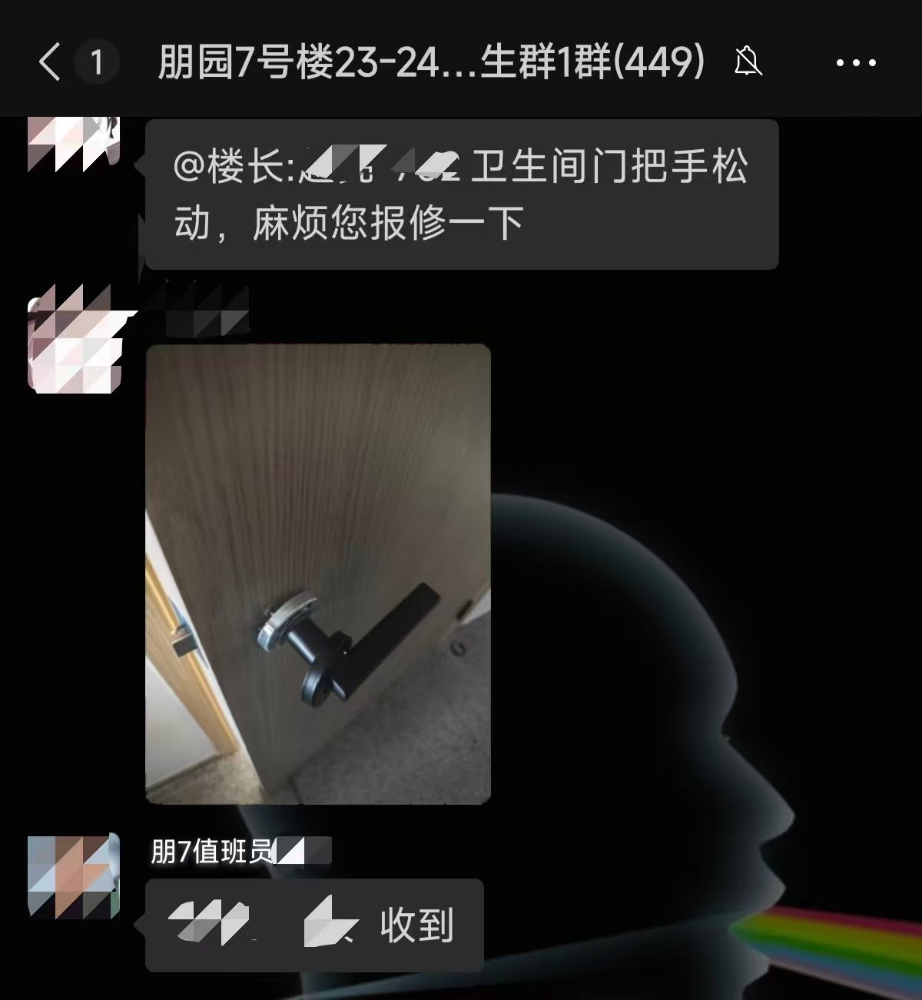
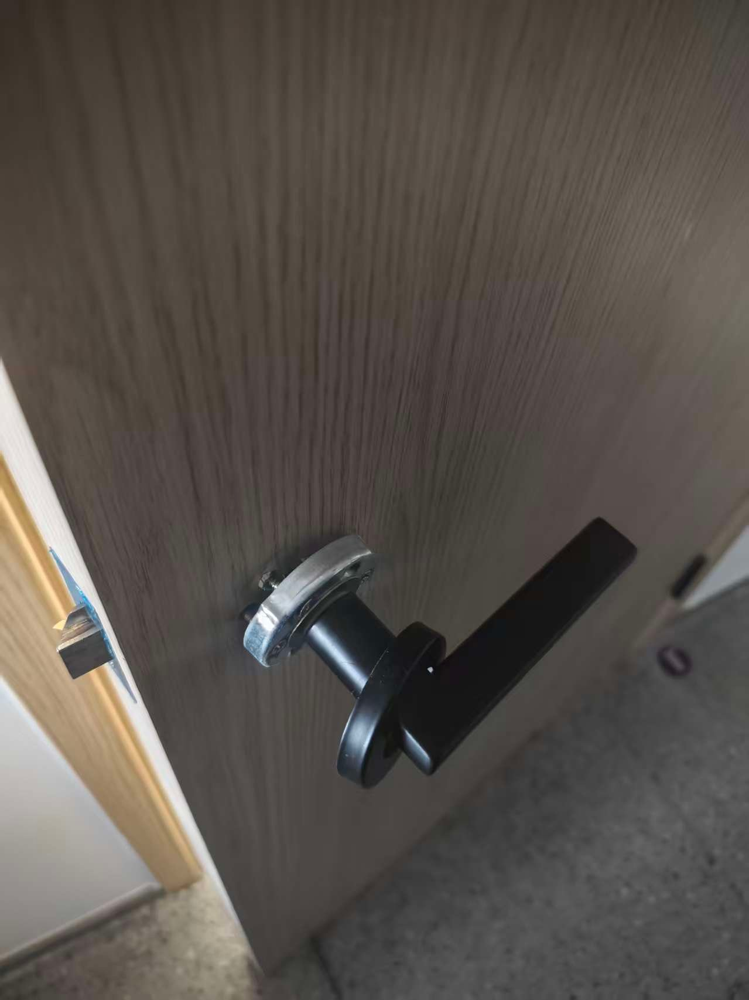

# 真实报修案例：卫生间门把手松动

## 一、案例概况

| 项目 | 内容 |
| --- | --- |
| 故障 | 卫生间门把手松动，开门时晃动明显 |
| 地点 | 宿舍卫生间 |
| 报修渠道 | 宿舍楼微信群 @ 楼长，附照片 |
| 当前状态 | 已修好，之后未再反馈 |

## 二、报修经过

B 开门进卫生间时发现门把手是松的，握住把手往下压，把手会跟着晃动，门还能正常开关和上锁，所以当时没有当成急事。

当天 B 在宿舍楼的微信群里 @ 楼长，写了一句卫生间门把手松动、麻烦您报修一下，附了一张门把手的照片。照片拍的是把手与门板连接的位置，能看到把手和门板之间有缝隙。

## 三、处理经过

群里的值班员回复了一句收到。

之后没有进一步的消息，B 不知道什么时候来人，也没有再问。

后续维修人员上门。当时 B 在宿舍，维修人员把门把手拆下来，重新对准位置装回去，拧紧了连接处的螺丝，前后大约十分钟。修完没有多说什么，也没有让 B 签字或确认，收拾工具就离开了。

## 四、确认修好

维修人员走后，B 当场开关了几次门，把手不再晃动，门也能正常关上，就认为修好了。

之后使用中把手没有再松，B 也没有在群里再提过这件事。

## 五、结果

门把手修好后一直正常，没有再出现松动。B 没有在群里再反馈，也没有人回访，这件事就此结束。

## 六、佐证材料

群聊截图：B 在群里 @ 楼长说明卫生间门把手松动，附门把手照片，值班员回复收到。

门把手照片：拍摄于报修当天，画面为把手与门板连接处。

